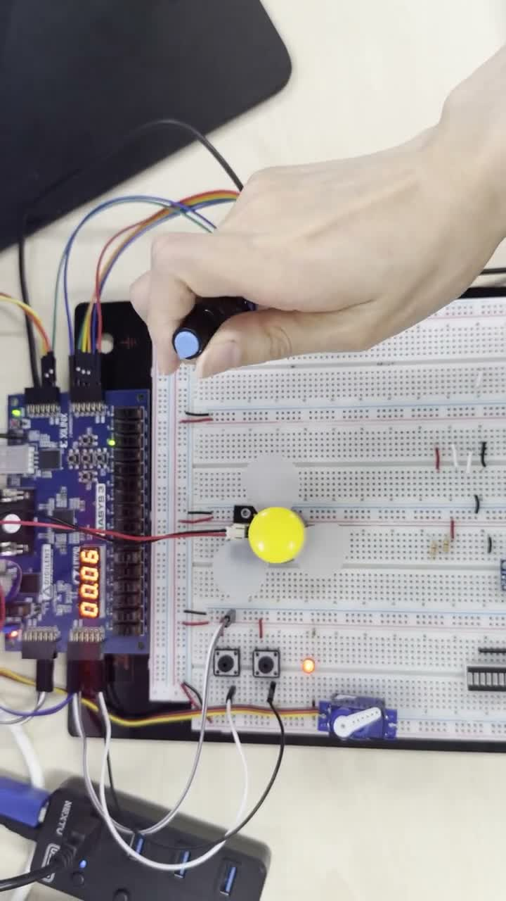
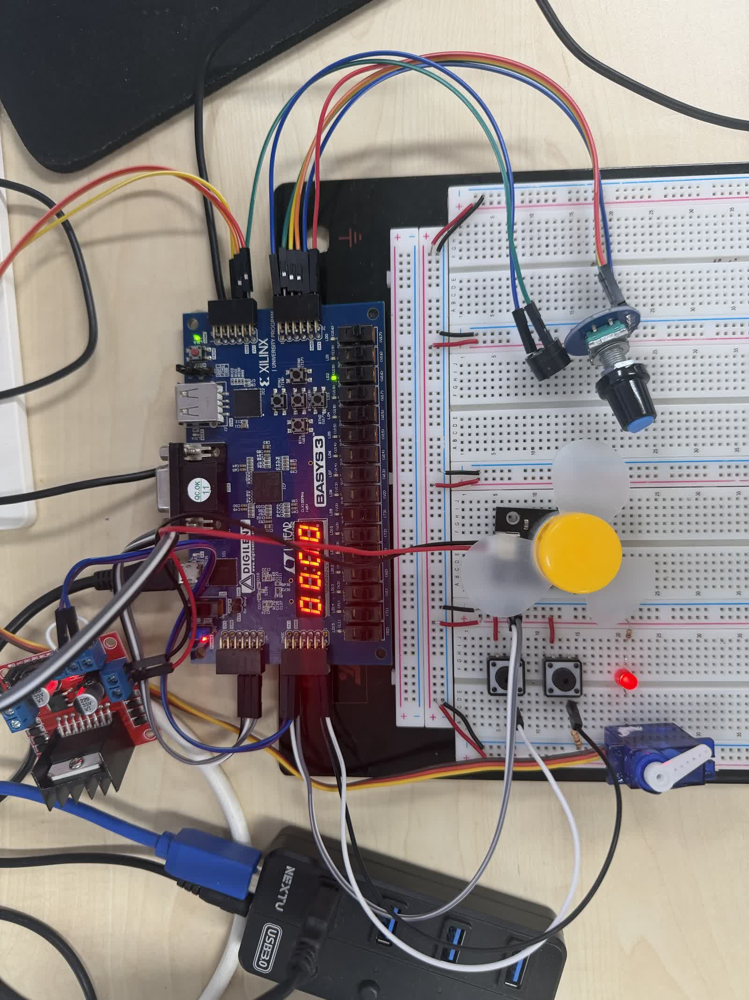
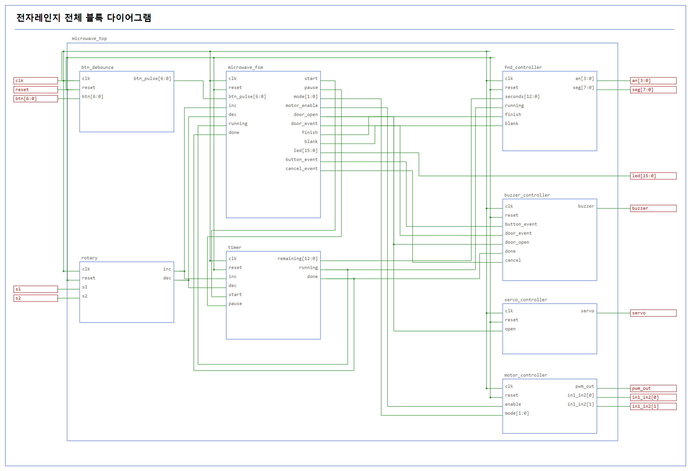
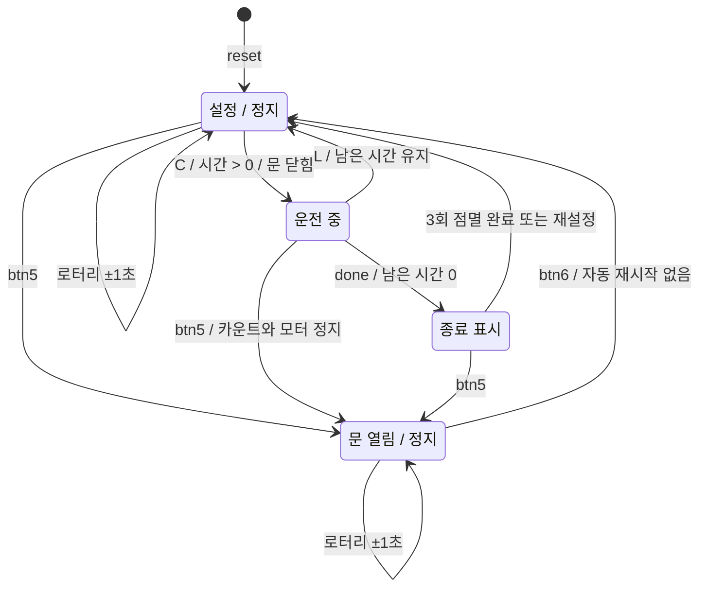
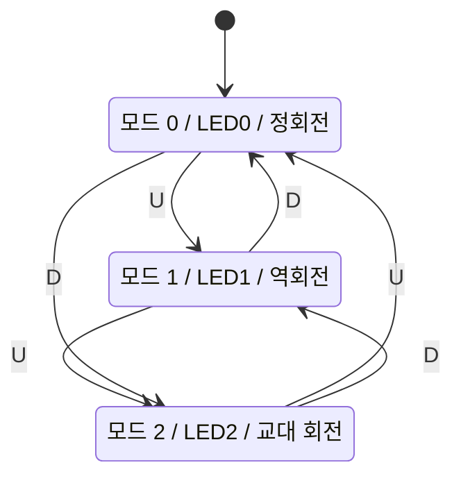

# FPGA Microwave Controller

Basys 3 FPGA와 Verilog로 전자레인지의 **시간 설정, 회전판 운전 모드, 문 개폐, 표시와 알림**을 구현한 프로젝트입니다.

로터리 엔코더로 시간을 설정하고 센터 버튼으로 시작합니다. 타이머가 동작하는 동안 모터를 구동하고, 시간이 끝나면 모터를 멈추며 FND 점멸과 종료 멜로디를 출력합니다. 문은 별도의 열기·닫기 버튼과 서보모터로 제어합니다.

## 동작 시연

<p align="center">
  <a href="docs/media/microwave_demo.mp4"></a>
</p>

**[▶ 동작 영상 보기 / 다운로드 — 약 34초](docs/media/microwave_demo.mp4)**

시연 영상에는 외부 버튼 조작에 따른 서보 암의 위치 변화, 로터리 조작과 FND 표시 변화, DC 모터 팬 동작이 담겨 있습니다. 영상은 브라우저 호환을 위해 H.264/AAC MP4로 변환했으며 촬영 순서는 유지했습니다. 기능별 상세 동작 조건은 아래 버튼 조작법과 FSM을 참고하세요.

## 제작 하드웨어

<p align="center">
  
</p>

Basys 3와 브레드보드에 입력·출력 장치를 연결한 하드웨어 시제품입니다. DC 모터와 프로펠러로 회전판 운전을 확인하고, 서보 암으로 문 개폐 동작을 모사합니다.

| 사진에서 확인되는 구성 | 프로젝트에서의 역할 |
|---|---|
| Basys 3 보드 | Verilog 제어 로직, 내장 버튼·LED·4자리 FND |
| 노브형 로터리 엔코더 | 조리 시간 설정 |
| 부저 | 버튼·문 상태·종료 알림 |
| 모터 드라이버와 DC 모터·프로펠러 | 회전판 운전과 방향 제어 확인 |
| 외부 버튼 2개 | 서보 열기·닫기 입력 |
| 마이크로 서보와 흰색 암 | 문 개폐 위치 제어 확인 |
| 브레드보드·점퍼선 | 장치 간 신호와 전원 연결 |

사진은 하드웨어 구성과 배선을 보여주는 자료이며, 세부 핀 연결은 아래 핀 배치 및 XDC를 기준으로 합니다.

## 개발 환경

| 항목 | 내용 |
|---|---|
| FPGA 보드 | Digilent Basys 3 |
| FPGA | XC7A35T-CPG236-1 |
| 개발 도구 | Xilinx Vivado 2020.2 |
| 언어 | Verilog HDL |
| 시스템 클록 | 100 MHz, 10 ns |
| 최상위 모듈 | `microwave_top` |
| 시간 표시 | 4자리 FND, MM:SS |

## 주요 기능

- 로터리 엔코더의 유효 4상 전이 한 사이클마다 시간을 **1초 증가/감소**합니다.
- 시간 범위는 **00:00~99:59**이며, 카운트다운 중에는 회전 입력을 무시합니다.
- 취소 후와 시간 종료 후에는 다시 시간을 설정하고 시작할 수 있습니다.
- **정회전 / 역회전 / 3초 간격 교대 회전**의 세 가지 모드를 지원합니다.
- 모터 EN은 운전 중 HIGH로 유지합니다. **듀티 조절이나 PWM 발진 없이 100% 구동**합니다.
- 문 열기·닫기는 별도 버튼으로 제어하며, 문을 열면 운전을 정지합니다.
- 운전 중 남은 시간과 원형 애니메이션을 1초씩 번갈아 표시합니다.
- 버튼음, 서로 다른 문 열림·닫힘 알림음, 종료 멜로디를 출력합니다.
- 시간 종료 시 FND의 `0000`을 0.5초 간격으로 ON/OFF 3회 표시합니다.

## 전체 블록 다이어그램



시간 설정 경로는 **`rotary → timer → fnd_controller`**입니다. `microwave_fsm`은 타이머의 시작/정지, 모터 허용, 문 상태, 종료 표시를 제어합니다. 타이머의 `done`은 FSM과 부저에 전달됩니다.

로터리는 별도 디바운서 없이 2단 동기화와 유효 전이 판정을 사용합니다. 일반 버튼 7개는 기존 코드의 10ms 디바운서를 통과한 후 한 번 누름 펄스로 변환됩니다.

## 버튼 조작

| 입력 | 기능 |
|---|---|
| 로터리 `s1`, `s2` | 정지 상태에서 시간 ±1초 |
| `btn[0]` / 센터 C | 시작, 취소 후 남은 시간으로 재시작 |
| `btn[1]` / U | 모드 증가: 0 → 1 → 2 → 0 |
| `btn[2]` / D | 모드 감소: 0 → 2 → 1 → 0 |
| `btn[3]` / L | 취소: 타이머·모터 정지, 남은 시간 유지 |
| `btn[4]` / R | 별도 동작 없음 |
| `btn[5]` / 외부 버튼 | 문 열기, 운전 중이면 정지 |
| `btn[6]` / 외부 버튼 | 문 닫기 |
| `reset` / SW15 | 시스템 초기화. 사용 시에는 0으로 유지 |

> 외부 버튼은 누르면 HIGH인 입력을 기준으로 합니다. 로터리 `key`는 사용하지 않습니다.

### 기본 사용 순서

1. SW15를 잠시 1로 올린 뒤 0으로 내려 초기화합니다.
2. 로터리를 돌려 시간을 설정합니다.
3. U/D로 운전 모드를 선택합니다.
4. 센터 C를 눌러 시작합니다.
5. L을 누르면 모터와 카운트다운이 멈춥니다. 정지 상태에서 시간을 조절하거나 C로 재시작할 수 있습니다.
6. 시간이 끝나면 모터 정지 → 종료 표시와 멜로디가 출력됩니다.
7. **로터리로 새 시간 설정 → C 시작**을 반복할 수 있습니다.

0초에서는 시작하지 않습니다. 문이 열려 있으면 시간을 설정할 수 있지만 시작은 막습니다. 문을 닫아도 자동 재시작하지 않으며, 이 버전에는 5초 자동 닫힘 기능이 없습니다.

## FSM: 운전과 문 제어

실제 코드는 `microwave_fsm`의 `door_open`, `finish`와 `timer`의 `running` 플래그로 동작을 나눕니다. 아래 상태도는 이 동작을 이해하기 쉽게 정리한 **개념 상태도**이며, 동일한 이름의 상태 enum이 코드에 존재하는 것은 아닙니다.




- 모든 상태에서 reset은 초기화 동작을 수행합니다.
- `running=1`일 때 로터리 입력은 시간에 반영하지 않습니다.
- 종료 점멸 중 로터리로 시간을 바꾸면 종료 표시를 중단하고 새 시간을 표시합니다.
- 문 열림 상태와 종료 표시 상태를 별도 상태 레지스터 하나로 구현하지 않고, 각 플래그와 출력 허용 조건으로 처리합니다.

### 모터 모드 FSM

| 모드 | LED | 동작 |
|---|---|---|
| 0 | LED0 | 정회전 |
| 1 | LED1 | 역회전 |
| 2 | LED2 | 정회전으로 시작해 3초마다 방향 반전 |



모드 선택과 실제 운전 허용은 별개입니다. `enable=0`이면 선택된 모드와 관계없이 EN·IN1·IN2를 모두 LOW로 출력합니다. 방향 변경 시에는 5ms 정지 구간을 둔 뒤 반대 방향을 활성화합니다.

## 소스 코드 구성

```text
fpga-microwave/
├── README.md
├── create_project.tcl
├── .gitignore
├── src/
│   ├── microwave_top.v
│   ├── microwave_fsm.v
│   ├── btn_debounce.v
│   ├── rotary.v
│   ├── timer.v
│   ├── fnd_controller.v
│   ├── buzzer_controller.v
│   ├── motor_controller.v
│   └── servo_controller.v
├── constraints/
│   └── basys3_microwave.xdc
└── docs/
    ├── CODE_GUIDE.md
    ├── MEDIA.md
    ├── operation_fsm.mmd
    ├── motor_modes.mmd
    ├── images/
    │   ├── block_diagram.png
    │   ├── operation_fsm.png
    │   ├── hardware_setup.jpg
    │   └── demo_preview.jpg
    └── media/
        └── microwave_demo.mp4
```

| 파일 | 역할 |
|---|---|
| [microwave_top.v](src/microwave_top.v) | 입력·제어·출력 모듈의 최상위 연결 |
| [microwave_fsm.v](src/microwave_fsm.v) | 시작·취소, 모드/LED, 문 상태, 종료 점멸 제어 |
| [btn_debounce.v](src/btn_debounce.v) | 제공한 7버튼 디바운서와 상승 에지 펄스 변환 |
| [rotary.v](src/rotary.v) | 2단 동기화, CW/CCW 전이 판정, inc/dec 펄스 |
| [timer.v](src/timer.v) | 시간 저장, ±1초 조절, 초 분주, 카운트다운과 done |
| [fnd_controller.v](src/fnd_controller.v) | MM:SS 변환, 자리 스캔, 애니메이션·시간 교대 표시 |
| [buzzer_controller.v](src/buzzer_controller.v) | 음계 발진기와 버튼/문/종료 이벤트 시퀀서 |
| [motor_controller.v](src/motor_controller.v) | 100% EN, 방향 선택, 3초 교대, 반전 대기 구간 |
| [servo_controller.v](src/servo_controller.v) | 50Hz 프레임과 문 위치별 펄스 폭 생성 |

자세한 신호 연결과 코드 설명은 [CODE_GUIDE.md](docs/CODE_GUIDE.md)에 정리했습니다. `play_melody`, FND 하위 모듈, 원본 `debouncer`는 해당 기능 파일 안에 포함되어 있습니다.

## 핀 배치

| 신호 | 보드 위치 | FPGA 핀 |
|---|---|---|
| clk | 100MHz oscillator | W5 |
| reset | SW15 | R2 |
| btn[0] / C | 센터 버튼 | U18 |
| btn[1] / U | 위 버튼 | T18 |
| btn[2] / D | 아래 버튼 | U17 |
| btn[3] / L | 왼쪽 버튼 | W19 |
| btn[4] / R | 오른쪽 버튼 | T17 |
| btn[5] | XA1_P / 열기 | J3 |
| btn[6] | XA2_P / 닫기 | L3 |
| s1 | JC2 | M18 |
| s2 | JC3 | N17 |
| buzzer | JC1 | K17 |
| servo | JB10 | C16 |
| pwm_out | JA1 / 드라이버 EN | J1 |
| in1_in2[0] | JA2 / IN1 | L2 |
| in1_in2[1] | JA3 / IN2 | J2 |

FND와 LED의 전체 핀은 [XDC](constraints/basys3_microwave.xdc)를 참고하세요. 외부 입력과 FPGA 출력 신호는 3.3V 규격을 사용합니다.

### 모터·서보 연결

- `pwm_out`이라는 포트 이름은 기존 배선을 유지하기 위한 이름입니다. 현재는 PWM 카운터 없이 운전 중 HIGH인 EN 신호로 사용합니다.
- DC 모터는 드라이버의 별도 모터 전원으로 구동하며, FPGA 핀은 제어 신호를 전달합니다. STBY가 있는 드라이버는 활성화가 필요합니다.
- 서보는 20ms 주기에서 **닫힘 1ms(0도), 열림 1.5ms(90도)** 펄스를 사용합니다.
- 서보 전원은 적절한 5V 전원에 연결하고 전원 GND와 FPGA GND를 공통으로 연결합니다. PWM 신호선은 JB10입니다.

## Vivado 실행

1. 저장소를 내려받습니다.
2. Vivado Tcl Console에서 저장소 폴더로 이동해 `source create_project.tcl`을 실행합니다. 새 프로젝트는 `vivado_project/`에 생성됩니다.
3. 직접 프로젝트를 만든다면 `src/*.v` 9개와 `constraints/basys3_microwave.xdc` 하나를 추가합니다.
4. 최상위를 `microwave_top`으로 지정합니다.
5. Synthesis → Implementation → Generate Bitstream 순서로 진행합니다.
6. Hardware Manager에서 보드에 프로그램하고 SW15를 0으로 유지합니다.

기존 로터리 프로젝트 XDC나 이전 통합 소스를 함께 등록하지 마세요. 코드의 `btn[6:0]`, `pwm_out`, `in1_in2[1:0]`와 XDC의 포트 이름이 일치해야 합니다.

## 구현 중 확인한 내용

- 제공된 로터리·디바운서·FND·음계 코드를 기반으로 기능을 통합했습니다.
- FND의 `posedge tick` 사용을 시스템 `clk` + tick enable로 변경하고, 조합회로 감도 목록을 `always @*`로 수정했습니다.
- 듀티 조절 회로를 제거하고 모터 EN 100% 구동으로 정리했습니다.
- XDC의 이전 포트명 때문에 생긴 IO placement 오류를 현재 최상위 포트명으로 수정했습니다.
- 개발 중 버전은 Vivado 2020.2에서 Basys 3 대상 합성·배치배선·100MHz 타이밍 검사를 통과했습니다.
- 실물 확인 과정에서는 서보를 교체한 뒤 동작한다는 사용자 확인을 받았습니다. 모든 동작을 자동 테스트로 검증한 것은 아닙니다.
- XSIM의 GCC 실행 환경 오류로 동작 시뮬레이션은 완료하지 못했습니다.

이 저장소는 교육용 기능 제어 구현입니다. 실제 문 위치 센서나 가열부 제어는 포함하지 않습니다.
