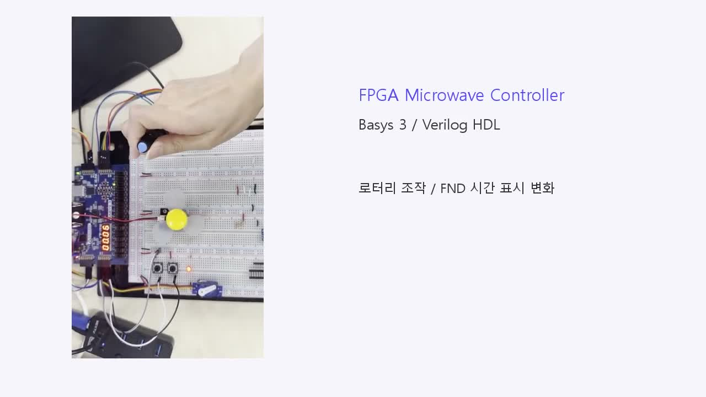
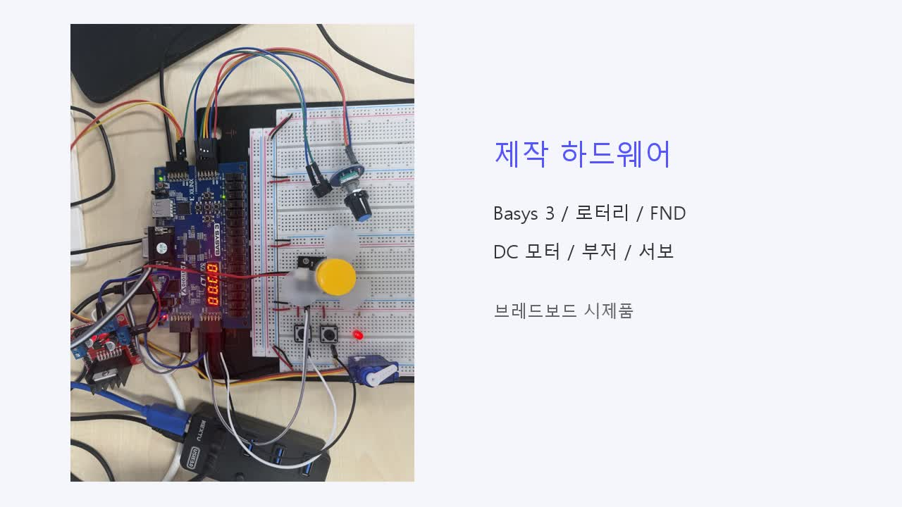
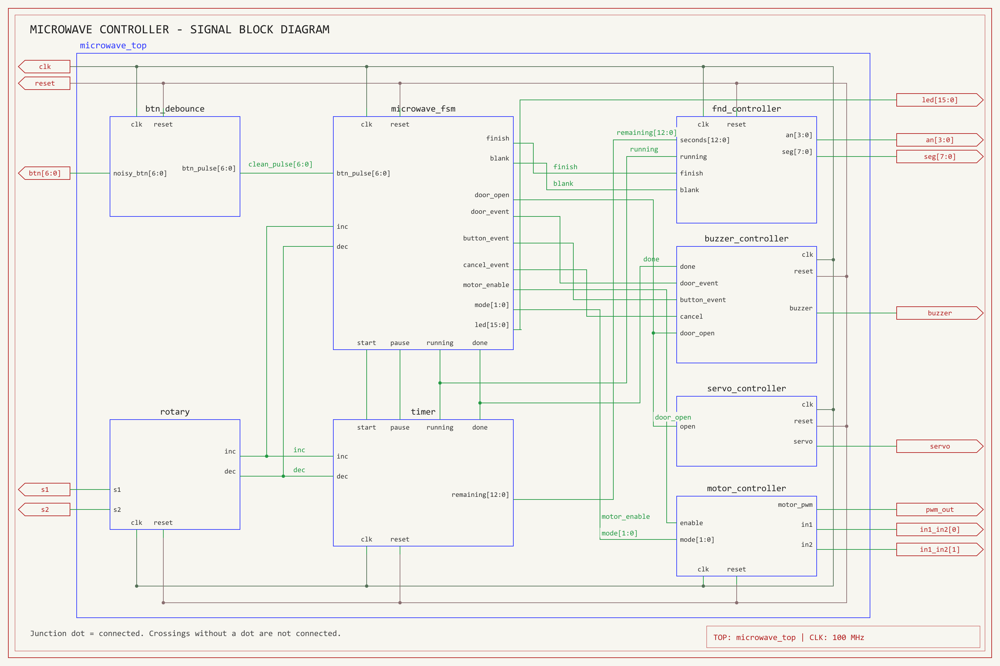
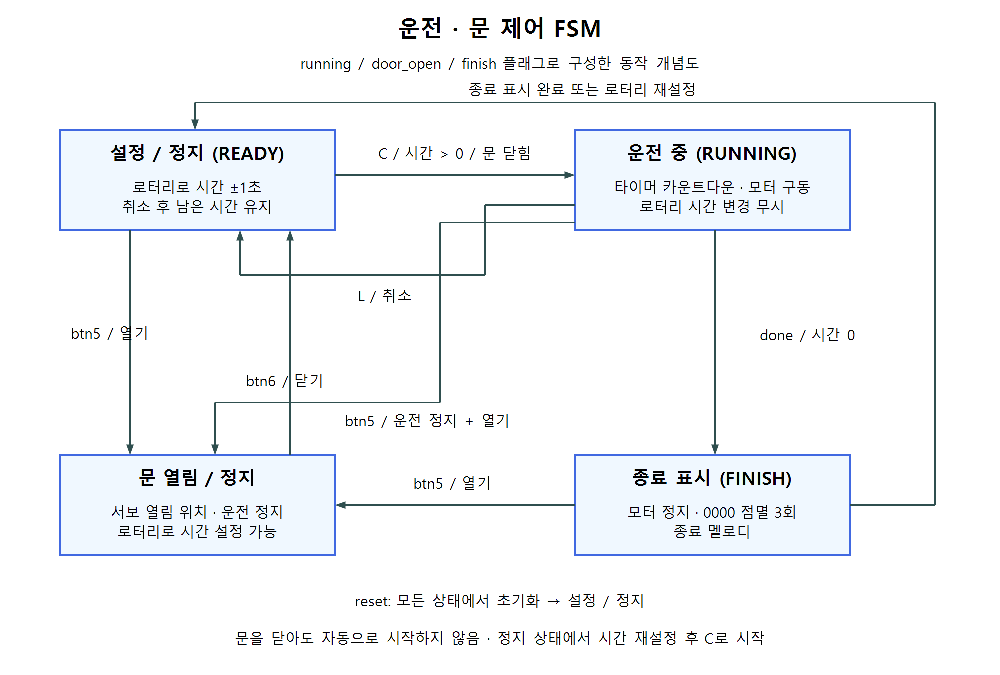
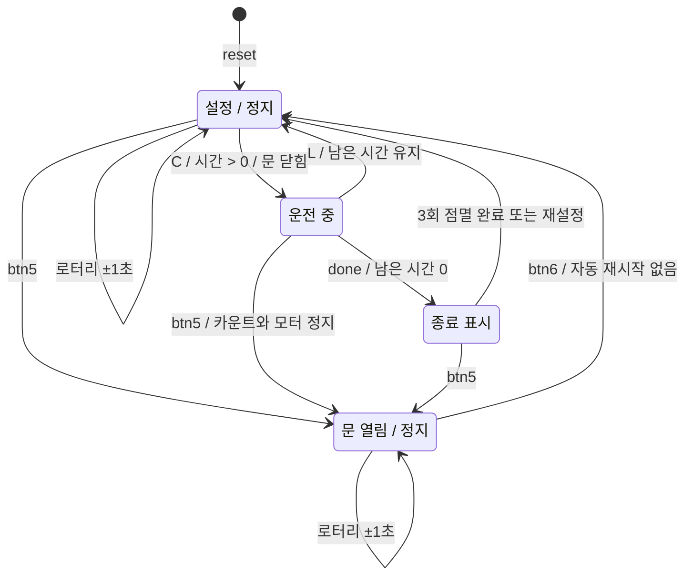
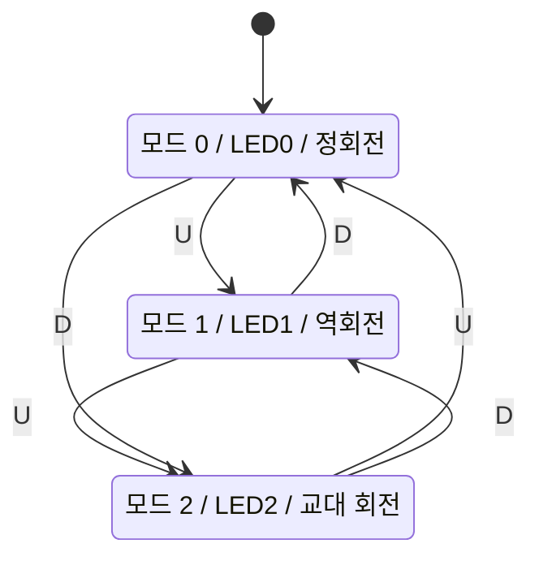

# FPGA Microwave Controller

**Basys 3와 Verilog HDL로 구현한 전자레인지 기능 제어 시스템**

로터리 시간 입력부터 카운트다운, 회전 모드, 문 개폐와 알림까지 FPGA에서 병렬로 제어했습니다. 입력 처리와 동작 제어, 장치 출력을 모듈로 나누고 `microwave_top`에서 연결했습니다.

| 구분 | 내용 |
|---|---|
| 플랫폼 | Basys 3, Artix-7 XC7A35T-CPG236-1 |
| 개발 환경 | Verilog HDL, Vivado 2020.2, 100 MHz |
| 구현 범위 | 시간 설정, 운전 제어, DC 모터 방향, 서보 위치, FND, 부저 |
| 개발 내용 | 기존 로터리·디바운서·FND·음계 코드를 재사용하고 제어 로직과 장치 인터페이스 통합 |
| 실물 구성 | 브레드보드 시제품. 팬으로 회전판 운전, 서보 암으로 문 개폐 모사 |

## 동작 시연

[](docs/media/microwave_demo_landscape.mp4)

**[동작 영상 보기](docs/media/microwave_demo_landscape.mp4)** · 약 34초 · 가로 1280×720 · 주요 장면 자막 포함

세로 촬영한 원본의 방향과 전체 장치를 유지한 채 가로 화면에 배치했습니다. 영상에는 문 개폐 버튼과 서보 암, 로터리와 FND, DC 모터 팬의 반응이 담겨 있습니다.

## 하드웨어 구성



Basys 3의 내장 버튼·LED·FND와 외부 로터리, 부저, DC 모터 드라이버, 서보를 연결했습니다. 사진은 실제 제작한 시제품이며 가열부와 문 위치 센서는 포함하지 않습니다.

## 구현 목표와 동작

시간 입력과 운전 중 입력을 구분하고, 취소·문 열기·타임아웃이 타이머와 모터에 일관되게 반영되도록 설계했습니다.

- 정지 상태의 로터리 한 사이클은 ±1초이며 범위는 00:00~99:59입니다.
- 센터 버튼으로 시작하고, 운전 중에는 로터리 시간 변경을 막습니다.
- 취소하면 남은 시간을 유지하고 정지합니다. 시간 수정과 재시작이 가능합니다.
- LED0은 정회전, LED1은 역회전, LED2는 3초 간격 교대 회전을 나타냅니다.
- 문 열기 입력은 운전을 정지시킵니다. 닫기 후에는 센터 버튼으로 다시 시작합니다.
- 타임아웃 시 모터를 정지하고 FND 0000을 3회 점멸하며 종료 멜로디를 냅니다.

## 전체 블록 다이어그램



[원본 크기로 보기](docs/images/microwave_block_filled.png) · [편집용 SVG](docs/images/microwave_block_filled.svg)

시간 설정 경로는 **`rotary → timer → fnd_controller`**입니다. `microwave_fsm`은 타이머의 시작/정지, 모터 허용, 문 상태, 종료 표시를 제어합니다. 타이머의 `done`은 FSM과 부저에 전달됩니다.

로터리는 별도 디바운서 없이 2단 동기화와 유효 전이 판정을 사용합니다. 일반 버튼 7개는 기존 코드의 10ms 디바운서를 통과한 후 한 번 누름 펄스로 변환됩니다.

## FSM: 운전과 문 제어

실제 코드는 `microwave_fsm`의 `door_open`, `finish`와 `timer`의 `running` 플래그로 동작을 나눕니다. 아래 상태도는 이 동작을 이해하기 쉽게 정리한 **개념 상태도**이며, 동일한 이름의 상태 enum이 코드에 존재하는 것은 아닙니다.





- 모든 상태에서 reset은 초기화 동작을 수행합니다.
- `running=1`일 때 로터리 입력은 시간에 반영하지 않습니다.
- 종료 점멸 중 로터리로 시간을 바꾸면 종료 표시를 중단하고 새 시간을 표시합니다.
- 문 열림 상태와 종료 표시 상태를 별도 상태 레지스터 하나로 구현하지 않고, 각 플래그와 출력 허용 조건으로 처리합니다.

### 모터 모드 FSM

| 모드 | LED | 동작 |
|---|---|---|
| 0 | LED0 | 정회전 |
| 1 | LED1 | 역회전 |
| 2 | LED2 | 정회전으로 시작해 3초마다 방향 반전 |



모드 선택과 실제 운전 허용은 별개입니다. `enable=0`이면 선택된 모드와 관계없이 EN·IN1·IN2를 모두 LOW로 출력합니다. 방향 변경 시에는 5ms 정지 구간을 둔 뒤 반대 방향을 활성화합니다.

## 핵심 코드와 설계 의도

### 1. 로터리 입력을 타이머에 직접 전달

[`rotary.v`](src/rotary.v)는 S1/S2를 2단 동기화한 뒤 CW·CCW 유효 전이를 누적합니다. 네 번의 전이마다 `inc` 또는 `dec`를 한 클록만 출력합니다. 별도 로터리 디바운서와 `key` 입력은 사용하지 않습니다. 동기화는 비동기 입력을 클록에 맞추는 처리이며 기계적 바운스를 모두 제거한다는 의미는 아닙니다.

```verilog
4'b0010,4'b1011,4'b1101,4'b0100:
 if(steps==3) begin steps<=0;inc<=1;end
 else steps<=steps+1'b1;
```

[`timer.v`](src/timer.v)는 시간 저장을 담당합니다. `running` 분기에서는 분주와 차감만 처리하므로 운전 중 로터리 입력이 시간을 변경하지 않습니다. 정지하면 입력을 다시 반영하고 `start`로 재시작합니다.

```verilog
if(pause) begin running<=0;count<=0;end
else if(running) begin
 // 100 MHz 기준 100,000,000클록마다 1초 차감
end else begin
 count<=0;
 if(inc && !dec && remaining<5999) remaining<=remaining+1'b1;
 else if(dec && !inc && remaining!=0) remaining<=remaining-1'b1;
 if(start && remaining!=0) running<=1;
end
```

위 코드는 원본의 핵심 분기를 발췌한 것입니다. 전체 카운트다운 처리는 소스 파일에서 확인할 수 있습니다.

### 2. 시작 조건과 모터 허용 조건 분리

[`microwave_fsm.v`](src/microwave_fsm.v)는 버튼 이벤트와 문 상태로 `start`, `pause`, `motor_enable`을 결정합니다. 문 열기와 취소를 누른 클록부터 모터 허용을 차단하며 문을 닫아도 자동으로 재시작하지 않습니다.

```verilog
assign start=btn_pulse[0] && !door_open
             && !btn_pulse[5] && !btn_pulse[3];
assign pause=btn_pulse[3] || btn_pulse[5]
             || (running && door_open);
assign motor_enable=running && !door_open
             && !btn_pulse[3] && !btn_pulse[5];
```

### 3. DC 모터와 서보의 출력 방식 구분

[`motor_controller.v`](src/motor_controller.v)의 `motor_pwm`은 기존 포트 이름을 유지한 EN 출력입니다. 운전 허용 시 HIGH를 유지하며 듀티 조절은 없습니다. 방향 변경 시에는 5ms 대기 구간을 거쳐 반대 방향을 활성화합니다.

```verilog
wire active=enable && ready && (current_dir==desired);
assign motor_pwm=active;
assign in1=active && !current_dir;
assign in2=active && current_dir;
```

[`servo_controller.v`](src/servo_controller.v)는 20ms 프레임에서 닫힘 1ms, 열림 1.5ms 펄스를 생성합니다. `frame_open`을 프레임 경계에서 갱신해 펄스 도중 명령이 바뀌어도 현재 프레임의 폭을 유지합니다.

```verilog
else if(count==1999999) begin count<=0;frame_open<=open;end
assign servo=(count<(frame_open?150000:100000));
```

### 4. 표시와 소리를 이벤트 기반으로 연결

[`fnd_controller.v`](src/fnd_controller.v)는 남은 초를 MM:SS로 변환하고 자리 선택을 순환합니다. 시스템 클록과 tick enable로 스캔을 수행하고, 운전 중 시간과 원형 애니메이션을 번갈아 표시합니다. [`buzzer_controller.v`](src/buzzer_controller.v)는 버튼, 문 상태 변화, `done`에 따라 음계 조합을 선택합니다.

| 모듈 | 책임 |
|---|---|
| `microwave_top` | 8개 기능 모듈의 신호 연결 |
| `btn_debounce` | 7개 버튼의 10ms 필터와 1클록 누름 펄스 |
| `rotary` | 유효 전이 누적과 증감 펄스 |
| `timer` | 시간 저장, 차감, 1클록 done |
| `microwave_fsm` | 모드, 문 상태, 운전 허용, 종료 표시 |
| `motor_controller` / `servo_controller` | 회전 방향과 위치 펄스 출력 |
| `fnd_controller` / `buzzer_controller` | 표시 스캔과 알림 시퀀스 |

전체 파일별 설명은 [코드 가이드](docs/CODE_GUIDE.md)에 정리했습니다.

## 기본 동작 테스트벤치

[`sim/tb_microwave.v`](sim/tb_microwave.v)는 복잡한 자동 검증 대신 실제 최상위 모듈에 입력을 넣고 기본 동작을 파형으로 확인합니다.

**확인 순서:** 로터리 시간 설정, 센터 시작, 운전 중 시간 변경 차단, 취소와 재시작, 문 열기·닫기, 모드별 방향, 타임아웃과 새 시작.

테스트를 짧게 실행하려고 버튼은 디바운스 완료 후 펄스를 넣고, 1초·3초 대기는 내부 카운터의 경계값으로 이동합니다. 원본 RTL은 수정하지 않습니다. 서보는 실제 20ms 프레임을 기다립니다. 자동 PASS 판정과 모든 경계 조건의 전수 검증은 포함하지 않습니다.

[실행 방법과 결과 기록 페이지](docs/VERIFICATION.md)에 파형 신호와 기대 동작을 정리했습니다. 현재 실제 동작 결과는 대기 중이며, 로그와 파형을 받으면 README와 PPT에 반영합니다.

## 개발 과정과 문제 해결

문제별 증상·분석·수정·확인 결과와 실제 로그·코드 비교는 [상세 트러블슈팅](docs/TROUBLESHOOTING.md)에 정리했습니다. [IO placement 오류 원문](docs/evidence/io_placer_error.txt), [XDC 수정 전후](docs/evidence/xdc_before_after.txt), [개발 중 DRC](docs/evidence/development_drc.txt) 등 확인 근거도 함께 제공합니다.

| 문제 | 분석과 변경 | 확인한 범위 |
|---|---|---|
| 취소·종료 뒤 시간 설정과 재시작 | 시간 저장을 timer에 두고 running일 때만 증감을 차단 | 코드 경로와 검증 시나리오 작성 |
| 모터 EN과 PWM 요구 혼동 | DC 모터 EN을 운전 중 HIGH로 고정하고 방향 출력을 분리 | 코드 연결과 영상의 팬 동작 확인. 약한 출력의 물리 원인은 미확정 |
| IO placement 오류 | 최상위 포트명·버스 폭과 XDC를 대조하고 중복 핀 제거 | 44개 활성 핀 중복 없음 |
| FND의 별도 tick 클록 사용 | 시스템 clk에서 tick enable로 상태 갱신 | 클록 경로 단순화 |
| 서보 미동작 | 핀 연결과 펄스 생성 경로를 분리해 확인하고 서보 교체 | 교체 후 사용자 동작 확인. 고장의 정량 원인은 미확정 |
| XSIM 실행 중 컴파일 실패 | RTL 분석 단계와 시뮬레이터 생성 C 컴파일 단계를 구분 | RTL 구문·정적 elaboration 통과, 실행 결과 보류 |

개발 중 버전은 Vivado 2020.2에서 합성·배치배선·100MHz 타이밍 검사를 통과했습니다. 이 사실과 새 테스트벤치의 동작 검증 결과는 구분합니다. 최종 소스에 대한 시뮬레이션 PASS와 타이밍 수치는 실제 로그를 기준으로 추가할 예정입니다.

## 구현 후기와 개선 방향

입력 처리, 제어 조건, 장치 구동을 나눠 설계하면서 같은 이벤트가 여러 출력에 일관되게 반영되도록 구성했습니다. 특히 취소 시 시간은 유지하고 모터는 즉시 차단하는 조건, 문 닫힘 후 수동 재시작 조건을 신호 단위로 정의했습니다.

다음 단계는 테스트벤치 결과를 기반으로 경계 조건을 보완하고, 로터리의 실제 바운스에 대한 내성을 측정하는 것입니다. 문 위치 센서와 별도 오류 상태를 추가하면 명령 상태와 실제 장치 상태도 구분할 수 있습니다.

## 버튼 조작

| 입력 | 기능 |
|---|---|
| 로터리 `s1`, `s2` | 정지 상태에서 시간 ±1초 |
| `btn[0]` / 센터 C | 시작, 취소 후 남은 시간으로 재시작 |
| `btn[1]` / U | 모드 증가: 0 → 1 → 2 → 0 |
| `btn[2]` / D | 모드 감소: 0 → 2 → 1 → 0 |
| `btn[3]` / L | 취소: 타이머·모터 정지, 남은 시간 유지 |
| `btn[4]` / R | 별도 동작 없음 |
| `btn[5]` / 외부 버튼 | 문 열기, 운전 중이면 정지 |
| `btn[6]` / 외부 버튼 | 문 닫기 |
| `reset` / SW15 | 시스템 초기화. 사용 시에는 0으로 유지 |

> 외부 버튼은 누르면 HIGH인 입력을 기준으로 합니다. 로터리 `key`는 사용하지 않습니다.

### 기본 사용 순서

1. SW15를 잠시 1로 올린 뒤 0으로 내려 초기화합니다.
2. 로터리를 돌려 시간을 설정합니다.
3. U/D로 운전 모드를 선택합니다.
4. 센터 C를 눌러 시작합니다.
5. L을 누르면 모터와 카운트다운이 멈춥니다. 정지 상태에서 시간을 조절하거나 C로 재시작할 수 있습니다.
6. 시간이 끝나면 모터 정지 → 종료 표시와 멜로디가 출력됩니다.
7. **로터리로 새 시간 설정 → C 시작**을 반복할 수 있습니다.

0초에서는 시작하지 않습니다. 문이 열려 있으면 시간을 설정할 수 있지만 시작은 막습니다. 문을 닫아도 자동 재시작하지 않으며, 이 버전에는 5초 자동 닫힘 기능이 없습니다.

## 핀 배치

| 신호 | 보드 위치 | FPGA 핀 |
|---|---|---|
| clk | 100MHz oscillator | W5 |
| reset | SW15 | R2 |
| btn[0] / C | 센터 버튼 | U18 |
| btn[1] / U | 위 버튼 | T18 |
| btn[2] / D | 아래 버튼 | U17 |
| btn[3] / L | 왼쪽 버튼 | W19 |
| btn[4] / R | 오른쪽 버튼 | T17 |
| btn[5] | XA1_P / 열기 | J3 |
| btn[6] | XA2_P / 닫기 | L3 |
| s1 | JC2 | M18 |
| s2 | JC3 | N17 |
| buzzer | JC1 | K17 |
| servo | JB10 | C16 |
| pwm_out | JA1 / 드라이버 EN | J1 |
| in1_in2[0] | JA2 / IN1 | L2 |
| in1_in2[1] | JA3 / IN2 | J2 |

FND와 LED의 전체 핀은 [XDC](constraints/basys3_microwave.xdc)를 참고하세요. 외부 입력과 FPGA 출력 신호는 3.3V 규격을 사용합니다.

### 모터·서보 연결

- `pwm_out`이라는 포트 이름은 기존 배선을 유지하기 위한 이름입니다. 현재는 PWM 카운터 없이 운전 중 HIGH인 EN 신호로 사용합니다.
- DC 모터는 드라이버의 별도 모터 전원으로 구동하며, FPGA 핀은 제어 신호를 전달합니다. STBY가 있는 드라이버는 활성화가 필요합니다.
- 서보는 20ms 주기에서 **닫힘 1ms(0도), 열림 1.5ms(90도)** 펄스를 사용합니다.
- 서보 전원은 적절한 5V 전원에 연결하고 전원 GND와 FPGA GND를 공통으로 연결합니다. PWM 신호선은 JB10입니다.


## 프로젝트 자료

- [포트폴리오 발표자료 PPT, 17장](docs/presentation/FPGA_Microwave_Portfolio.pptx)

- [상세 트러블슈팅과 증거 자료](docs/TROUBLESHOOTING.md)

- [Vivado 프로젝트 빌드](docs/BUILD.md)
- [검증 방법 및 결과 기록](docs/VERIFICATION.md)
- [모듈별 코드 가이드](docs/CODE_GUIDE.md)
- [사진·영상 정보](docs/MEDIA.md)
